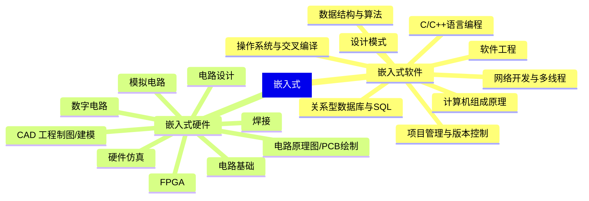
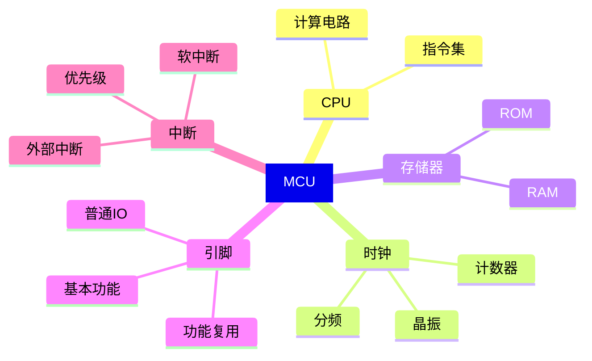

# 嵌入式开发

## 一、所谓嵌入式，就是把人嵌到墙里去的招式！

### 1.1 嵌入式的划分
简单的，实际的，出于实用性的，我们可以将嵌入式系统大致分为两个部分。
软件和硬件（￣︶￣）↗　（认真讲废话）

以单片机与所需的外围器件搭建的电路部分，划分为硬件设计。
通过对单片机编程来实现我们需要的功能，划分为软件编程

### 1.2 嵌入式的知识体系

关于这篇教程大体会讲什么 AND 这本教程之外你可以自己去学什么——

建议扫一眼有个印象就得了，不要太去在意——更没必要在这个阶段把这些书全买回来研究。
这玩意就是个大概的“培养方案”或者说“目录大纲”

## 二、所谓单片机，就是用单刀把人片片解离的技击！

### 2.1 对 MCU 的基本理解

  
  



大体来说，对于一个什么都不会都不知道刚入门的嵌入式小白来说，理解这张图是刚好合适的——

如果你的右脑图像处理能力不足以解析这幅图的话（通常而言图像解析处理能力与右脑的发育程度有关），又或者你连这些名词都看不懂的话，可以阅读以下内容：

一个MCU的功能可以大概的分为五个模块，分别是 CPU、时钟、存储器、引脚和中断。

#### 1.1.1 CPU

其中CPU部分负责核心的计算功能，根据输入指令的不同，能够接通不同的计算电路。  

不同CPU的输入指令和计算电路的对照关系不同，例如某系列CPU的加法指令可能是`00001000`,但；另一系列CPU的加法指令却是`00001011`。

将每种 CPU 的输入指令和计算电路的对应关系整理成一个对照集，就是所谓的指令集。

#### 1.1.2 时钟

MCU 的运行需要一个稳定均匀的在高低电平之间反转的输入，以便对齐多个线路各种操作的时间，这个原件焦作晶振。  

有的 MCU 在芯片内内置了晶振，有的MCU需要在外部电路中提供晶振。

通过计算检测的高低电平次数，我们可以实现定时与计数，这种电路叫“定时器/计数器”

有些时候晶振产生的频率并不适合我们的实际需要，我们可以通过分频（降低频率）与倍频（增高频率）等方式来调整时钟输入的翻转频率

#### 1.1.3 存储器

字面意思，用来存储内容的

#### 1.1.4 中断

> 中断是指计算机运行过程中，出现某些意外情况需主机干预时，机器能自动停止正在运行的程序并转入处理新情况的程序，处理完毕后又返回原被暂停的程序继续运行。

直接念定义的话可能不太好理解。

乃们可以这么想，事有轻重缓急——当你正在慢慢悠悠看小说，突然闻到锅糊了，这时候你得停止看小说，先跑去把火关上才能回来继续看。

而中断的优先级，就是重要的事情也分轻重缓急，你正在看小说，锅糊了，同时跳闸了。

你肯定得先把锅关了，再去合电闸。

#### 1.1.5 引脚

嵌入式开发中最直观要控制的东西，芯片的管脚。

基本的功能管脚、例如电源管脚 VCC、GND，重置管脚 RST 等是确定的我们不能修改的。  

普通的IO管脚是我们可以用来读取上面的电压或者设置上面的电压，用于做输入输出的。  

有一些常用的功能，直接用软件实现又麻烦运行效率又差，因此设计成了专门的电路并连接到部分IO管脚上，只要在编程时设置这些引脚的运行模式，就能使用这些预先设计好的功能，这叫引脚的功能复用。

### 3.2 从软件编程-->到嵌入式编程
#### 3.2.1 电平与变量的值
现在你已经掌握了最基本的C语言编程，如何将软件代码与硬件电路结合起来呢？

首先引入两个概念
1. 电流从高电平流向低电平。
2. 数字电路里高电平是1，低电平是0。

然后导入一个理解
3. 单片机的IO引脚可以像变量一样操作。

那么，假设一个灯连接在Pin1和Pin2两个引脚之间，我们该如何让它亮起来呢？
look：
```c
while() //让单片机跑一个死循环防止程序结束
{
	Pin1=1; //点亮灯泡
	Pin2=0; //根据不同MCU提供的库不同，具体语法会有所不同
}

```
这就是最简单的单片机编程。
#### 3.2.2 时钟频率与延时 
计算机的本质其实也就是基于数字电路，数字电路中各种触发器或者集成芯片都需要一个clk输入，这个输入是均匀的方波，（大概就是01010101.......这样）

一个数字电路系统中可能有很多个模块，例如好几个触发器要在合适的时候锁定，电路状态是会变化的，怎么告知触发器什么时候合锁定呢？

CLK：我特马来辣！

把各个触发器都设计成当检测到clk电压0变1的时候锁定，就能避免电路的不同部分输出有先有后导致数据出错了。
通过时钟信号，整个完整的电路才能稳定的按照正确的时序，正确的执行输入指令。

这个clk通常由一个名为晶振的元器件生成。
俗称晶振。
晶振每秒产生方波的数量叫做时钟频率。

然后，每条指令执行时间不一定是相同的，有得指令可能需要两个方波，有的可能需要三个、四个，这个叫指令周期（这些术语在开发里其实没啥大用，理解有这么个东西就行没必要费时间记）

知道时钟频率和指令周期之后，我们就可以据此来实现所需时长的延时了

例如以8051单片机为例,时钟频率12MHZ，while空转的指令周期是6x2，要延时20ms，就可以写成这样
```c
void Delay20ms(void)	//@12.000MHz
{
	unsigned char data i, j;

	i = 39;
	j = 230;
	do
	{
		while (--j);
	} while (--i);
}
```
（什么？你问我39和230是怎么计算出来的？我有病吗自己算这玩意。直接拿芯片官方给的工具生成不就完了-->`stc-aicube-isp`）


#### 3.2.3 中断与优先级 
前文讲过了，中断就类似你看书看半截闻到糊味，就得先去关火。
优先级就是这些突发情况之间也分比较严重和特别严重，要优先处理最严重的。

具体实现上。。。。就是按要求编写中断后的处理函数

中断的优先级根据不同MCU或者开发环境也会有所不同。
例如Arduino的中断优先级如下

```javascript
1 Reset 
2 External Interrupt Request 0 (pin D2) (INT0_vect) 
3 External Interrupt Request 1 (pin D3) (INT1_vect) 
4 Pin Change Interrupt Request 0 (pins D8 to D13) (PCINT0_vect) 
5 Pin Change Interrupt Request 1 (pins A0 to A5) (PCINT1_vect) 
6 Pin Change Interrupt Request 2 (pins D0 to D7) (PCINT2_vect) 
7 Watchdog Time-out Interrupt (WDT_vect) 
8 Timer/Counter2 Compare Match A (TIMER2_COMPA_vect) 
9 Timer/Counter2 Compare Match B (TIMER2_COMPB_vect) 
10 Timer/Counter2 Overflow (TIMER2_OVF_vect) 
11 Timer/Counter1 Capture Event (TIMER1_CAPT_vect) 
12 Timer/Counter1 Compare Match A (TIMER1_COMPA_vect) 
13 Timer/Counter1 Compare Match B (TIMER1_COMPB_vect) 
14 Timer/Counter1 Overflow (TIMER1_OVF_vect) 
15 Timer/Counter0 Compare Match A (TIMER0_COMPA_vect) 
16 Timer/Counter0 Compare Match B (TIMER0_COMPB_vect) 
17 Timer/Counter0 Overflow (TIMER0_OVF_vect) 
18 SPI Serial Transfer Complete (SPI_STC_vect) 
19 USART Rx Complete (USART_RX_vect) 
20 USART, Data Register Empty (USART_UDRE_vect) 
21 USART, Tx Complete (USART_TX_vect) 
22 ADC Conversion Complete (ADC_vect) 
23 EEPROM Ready (EE_READY_vect) 
24 Analog Comparator (ANALOG_COMP_vect) 
25 2-wire Serial Interface (I2C) (TWI_vect) 
26 Store Program Memory Ready (SPM_READY_vect)
```
**（谁要是浪费时间记这玩意，我能笑他一年）**
#### 3.2.4 Read the fucking manual !
翻译成中文是：去读他喵的文档

嵌入式开发的本质是阅读电路与文档的能力。基本的概念说完了，还需要我讲什么？
带着你遍历一遍全天下所有的单片机所有的总线协议所有的指令集吗？

入门所必需的理论知识就这么多，该实践了mybro~

你当然可以背的下某几款MCU的全部引脚定义和全部寄存器，努努力你甚至能背的下一个系列——但你能背的下所有系列所有型号吗？

你当然可以找到并记住几个常用通用传感器的（被简化后的）代码控制逻辑——你能记得住所有的传感器吗？那些市面上还没有人总结过的新型号传感器怎么办？

例如当你费劲千辛万苦学会了STM32F103C8AT6MCU+带驱动板双PWM电机的开发。然后发现任务需求是在GD32F407VET6上驱动四相五线步进电机。你就不干了吗？还是说打个报告“这个MCU和传感器我没有学习过，请给我批几个月假期去学习一下”？

<猫猫叹气>  
何必呢？

所以说就嵌入式开发的学习来说，在单一MCU或模块的基本功能上耗费太多时间其实是没有什么必要的。其实学习嵌入式真正要学习的东西是阅读电路和阅读手册文档的能力啊。

引脚分布图datasheet上不是有吗？  
寄存器定义对应MCU的手册上不是有吗？  
传感器和功能模块、通信协议的原理逻辑和控制时序对应的资料手册上不是也有吗？  
甚至商家还会给你带基本的驱动库和例程。

如果你有足够的阅读电路和阅读手册文档的能力，只要GET一本MCU手册，GET所需的模块手册，其实即使是完全陌生的MCU和模块也可以直接上手使用，不是吗？

## 3.2.5 最基本的嵌入式编程实践
以下，是一些 IDE 和 MCU 的电灯代码——别误会，我不是说真的要你们一上来就学习这么多IDE和这么多MCU，更不是说某些IDE固定只能开发对应MCU.

<font color=red>我列举这么多种的目的是在于清清楚楚的明示你：尽管有这么多种 IDE 和不同的 MCU ，但在编程上，除了不同芯片的头文件和函数命名不同外，它们的实现逻辑都完全一样！</font>
 
### 3.2.5.1 Keil-MDK uvision + STC89C52RC REG51定义
```cpp
#include <reg52.h>

// 简单延时函数
void Delay_ms(unsigned int ms) {
    unsigned int i, j;
    for (i = 0; i < ms; i++) {
        for (j = 0; j < 120; j++); // 大约 1ms @ 12MHz
    }
}

void main(void) {
    // 配置 P1.0 为推挽输出（51 默认就是准双向口，可直接输出）
    // 无需额外配置

    while (1) {
        P1_0 = 0;   // 低电平点亮 LED
        Delay_ms(1000);

        P1_0 = 1;   // 高电平熄灭 LED
        Delay_ms(1000);
    }
}
```
### 3.2.5.2 Clion + STM32F407VET6 HAL库
```cpp
#include "stm32f4xx_hal.h"

void GPIO_Init(void) {
    HAL_Init();             // 1. HAL 库初始化
    SystemClock_Config();   // 2. 系统时钟配置（CubeMX 生成）
    GPIO_InitTypeDef GPIO_InitStruct = {0};

    // 使能 GPIOF 时钟
    __HAL_RCC_GPIOF_CLK_ENABLE();

    // 配置 PF9 为推挽输出
    GPIO_InitStruct.Pin = GPIO_PIN_9;
    GPIO_InitStruct.Mode = GPIO_MODE_OUTPUT_PP;
    GPIO_InitStruct.Pull = GPIO_NOPULL;
    GPIO_InitStruct.Speed = GPIO_SPEED_FREQ_LOW;
    HAL_GPIO_Init(GPIOF, &GPIO_InitStruct);

    // 默认熄灭 LED
    HAL_GPIO_WritePin(GPIOF, GPIO_PIN_9, GPIO_PIN_SET);
}

int main(void) {
    GPIO_Init(); 

    while (1) {
        HAL_GPIO_WritePin(GPIOF, GPIO_PIN_9, GPIO_PIN_RESET); // 点亮
        HAL_Delay(1000);
        HAL_GPIO_WritePin(GPIOF, GPIO_PIN_9, GPIO_PIN_SET);   // 熄灭
        HAL_Delay(1000);
    }
}


```
### 3.2.5.3 VS-Code + STM32F103C8T6 标准库
```cpp
#include "stm32f10x.h"

// 简单延时函数
void Delay_ms(uint32_t ms) {
    uint32_t i;
    while (ms--) {
        for (i = 0; i < 8000; i++); // 大约 1ms @ 72MHz
    }
}

void gpioinit() {
	// 使能 GPIOC 时钟
    RCC_APB2PeriphClockCmd(RCC_APB2Periph_GPIOC, ENABLE);

    // 配置 PC13 用于推挽输出
    GPIO_InitTypeDef GPIO_InitStructure;
    GPIO_InitStructure.GPIO_Pin = GPIO_Pin_13;
    GPIO_InitStructure.GPIO_Speed = GPIO_Speed_50MHz;
    GPIO_InitStructure.GPIO_Mode = GPIO_Mode_Out_PP; // 推挽输出
    GPIO_Init(GPIOC, &GPIO_InitStructure);
}

int main(void) {
	gpioinit();
    while (1) {
        GPIO_ResetBits(GPIOC, GPIO_Pin_13); // 低电平点亮 LED
        Delay_ms(1000);                     // 延时 1 秒

        GPIO_SetBits(GPIOC, GPIO_Pin_13);   // 高电平熄灭 LED
        Delay_ms(1000);                     // 延时 1 秒
    }
}
```
### 3.2.5.4 Arduino + ESP32S3R8 Arduino库
```cpp
/*
  ESP32-S3R8 Arduino 点灯示例
  功能：板载 LED 每隔 1 秒闪烁一次
*/

// 定义板载 LED 引脚
// ESP32-S3R8 板载 LED 一般连接在 GPIO48
#define LED_PIN 48

void setup() {
  // 设置 LED 引脚为输出模式
  pinMode(LED_PIN, OUTPUT);
}

void loop() {
  // 点亮 LED
  digitalWrite(LED_PIN, HIGH);
  delay(1000); // 延时 1 秒

  // 熄灭 LED
  digitalWrite(LED_PIN, LOW);
  delay(1000); // 延时 1 秒
}
```

### 3.2.5.4 概括
发现了吗？尽管随mcu不同，头文件和函数命名有所不同，但是就电灯这一事件而言，都是给某个引脚输出高电平，延时，再给引脚输出低电平，再延时。

逻辑完全一样！

也就是说，从某种意义上，你可以理解为“**所有 MCU ，在所有 IDE 下的编程都大体相同”

## 六、你可卑微如尘土，不可屈膝向未知。如果玄幻的道路走不通，那就数学封神！出来吧！数字电路

### 二进制八进制十进制十六进制

1. N 进制中，单个数位上能表示的最大数字是 (N-1)
	1. 二进制 0 1
	2. 八进制 0 1 2 3 4 5 6 7
	3. 十进制 0 1 2 3 4 5 6 7 8 9
	4. 十六进制 0 1 2 3 4 5 6 7 8 9 A B C D E F
2. 二进制和八进制十六进制的关系
	1. 2x2x2=8，所以三位二进制可以表达一位八进制数，每个位置上的位置对应的是4 2 1，例如二进制101=4+1=八进制5
	2. 2x2x2x2=16，所以四位二进制可以表达一位十六进制数，每个位置上的位置对应的是8 4 2 1，例如1101=8+4+1=十六进制D
	3. 所以二进制可以直接按三位一组拆成八进制或者四位一组拆成十六进制，例如二进制101001010111可以拆成八进制5127也可以拆成十六进制A57
3. 位 字 字节
	1. 位（Bit），就是一位二进制数，一般缩写成小写b，例如15b，2Kb
	2. 字节（Byte）基本单位，八位二进制数为一字节，一般缩写为大写B，例如25B，50KB
	3. 字（Word）又叫字长，CPU一次能处理的二进制数据宽度上限，例如现在常见的电脑手机大都是64位，以前的老设备是32位，，有的单片机芯片是8位或16位
	4. 表面看起来计算机单位好像是千进制，1000B=1KB，1000KB=1MB，1000MB=1GB,1000GB=1TB,但是在现实中，计算机是以2进制为基础的，2的十次方刚好是1024，因此计算机单位的单位其实是1024B=1KB，1024KB=1MB，1024MB=1GB,1024GB=1TB，所以你买的u盘硬盘什么的插电脑上识别的大小都比盒子标的小
### 串行与并行
#### 并行
同时使用多条数据线路，同时传输多个数据位。  

```  

发送端                    接收端  

D0 ──────────────────────→ D0    (第 1 位)  

D1 ──────────────────────→ D1    (第 2 位)  

D2 ──────────────────────→ D2    (第 3 位)  

D3 ──────────────────────→ D3    (第 4 位)  

D4 ──────────────────────→ D4    (第 5 位)  

D5 ──────────────────────→ D5    (第 6 位)  

D6 ──────────────────────→ D6    (第 7 位)  

D7 ──────────────────────→ D7    (第 8 位)  

     ↑     8 条数据线同时传输  

```
### 串行
使用一条数据线，按时间顺序逐位传输数据。  
```  

发送端 ─────────────────────→ 接收端  

         单条数据线         时间 T1: 传输第 1 位  

时间 T2: 传输第 2 位  
时间 T3: 传输第 3 位  
...  
时间 T8: 传输第 8 位  
```
### 实际应用
95%都是串行和串行的变种（多通道串行、差分、协议调制）
### 校验
传输是可能出错的，所以很多时候要校验传输过程中是否出错，但校验是对性能和速率有影响的，越复杂的校验影响越大，所以大多数时候普通的数据校验也就是简单校验一下甚至不做校验。，
**1. 奇校验**  
把数据里所有1加起来看是不是奇数，是的话末尾追加一位0，否则追加1
**2. 偶校验**
把数据里所有1加起来看是不是偶数是的话末尾追加一位0，否则追加1
**3. 校验和**
把数据分成多段加起来得到一个结果附在最后，按分段长度和进位处理方式不同有多个变种，常见的是按照字节分开累加，对256取模（字节最大表示范围就是0-255）（取模就是取余数）
**4. CRC 循环冗余校验**
基于多项式除法的原理，将数据看作一个多项式的系数，用一个预定义的生成多项式去除，得到的余数作为校验码。同样有多个变种。
### 逻辑门
这里用 · 表示与，+ 表示或，′ 表示取反，⊕ 表示异或。

#### 与 AND x
可以简单理解为乘法，多个输入与到一起，只要有一个是0，乘法结果就是0，输出就是0
逻辑式写法 `A · B`
#### 或 OR +
可以简单理解为加法，多个输入或到一起，只要有一个是1，乘法结果就不为0，数电逻辑不为0就是1
逻辑式写法 `A + B`
#### 非 NOT ——
直接理解成取反就行，0变1，1变0
逻辑式写法 `A′`
####  与非 NAND
就是与门后面串个非门，与非门是逻辑完善的，通过多个与非门组合可以实现其它所有逻辑门
逻辑式写法 `(A · B)′`
#### 或非 NOR
就是或门后面串个非门。
逻辑式写法 `(A + B)′`
#### 异或 XOR
两个输入，相同为0，不同为1
逻辑式写法 `A ⊕ B`
#### 同或 XNOR
两个输入，相同为1，不同为0
逻辑式写法 `(A ⊕ B)′`
### 逻辑式与逻辑式化简
#### 逻辑式写法
逻辑门里教了，把逻辑连起来写就是逻辑式
#### 真值表
就是把所有输入和输出的对应关系拉一个表格
#### 逻辑化简
跟数学一样，可以用交换律、结合律和等价代换。比如按德摩根律，`(A · B)′ + C = A′ + B′ + C`：与非相当于把两个输入分别取反后再做或运算。变量多的时候，可以用卡诺图化简。
#### 卡诺图的结构

所谓格雷码，就是相邻编码只变一位。两位格雷码按 `00 → 01 → 11 → 10` 排列，首尾的 `10` 和 `00` 也只差一位。四变量卡诺图用这套顺序排列行标签 `AB` 和列标签 `CD`。因此最上行与最下行相邻，最左列与最右列也相邻；斜对角不算相邻。

#### 卡诺图化简

例：化简 **F(A, B, C, D) = Σm(0, 2, 8, 10, 11, 14, 15)**。这里的 m 是输入 `ABCD` 对应的十进制编号，例如 `1010` 是 m10。列出的编号输出为 1，其余输出为 0。


1. **从真值表填图。** 取输入的前两位找行、后两位找列。例如 m10 对应 `AB=10`、`CD=10`，所以在右下角填 1。
2. **圈住所有的 1。** 每圈必须是矩形，含 1、2、4、8 或 16 格，不得包含 0。四个角跨上下、左右边界组成一圈；右下的 2×2 方块组成另一圈。两圈在 m10 重叠，正好覆盖全部七个 1。
3. **只写圈内不变的变量。** 变量恒为 1 写原变量，恒为 0 写反变量。四角圈的 B、D 恒为 0，得到 **B′D′**；右下圈的 A、C 恒为 1，得到 **AC**。两项相或，得 **F = B′D′ + AC**。

如果某些输入的输出无需规定，可用 `×` 标记为无关项；只有在它能帮助组成更大的圈时才把它当作 1，无关项本身不用覆盖。

## 触发器与状态保存
触发器有两种稳定状态，在外部不输入变化信号的情况下能保持0或1输出不变，可以保存一位二进制状态
### 各种触发器
**1. RS触发器**

最基础的触发器，有两个输入R（复位）和S（置位）


- R=1, S=0：复位，输出Q=0
- R=0, S=1：置位，输出Q=1
- R=0, S=0：保持，输出不变
- R=1, S=1：禁止如此使用，输出不确定

**实现原理：**
两个与非门交叉耦合，形成反馈回路
工作原理：当S=0时，强制Q=1；当R=0时，强制Q=0；两者都为1时保持状态

**2. D触发器**

最常用的触发器，只有一个数据输入D和时钟输入CLK


  

- 时钟上升沿（或下降沿）到来时，把D的值传到输出Q
- 相当于一位数据的暂存
- 广泛用于寄存器、计数器、移位寄存器
- CLK=1时主锁存器接收D，CLK=0时从锁存器接收主锁存器输出，实现边沿触发

**3. JK触发器**
功能最完善的触发器，J和K两个输入
- J=0, K=0：保持
- J=0, K=1：复位，Q=0
- J=1, K=0：置位，Q=1
- J=1, K=1：翻转，Q变为相反值
- 解决了RS触发器的禁止状态问题

**实现原理：**

在RS触发器基础上增加反馈，用与非门实现


J和K通过反馈网络控制RS触发器，当J=K=1时输出翻转
**4. T触发器**
翻转触发器，只有一个T输入，有点类似于自锁开关，按一下关，再按一下开
- T=0：保持
- T=1：翻转，Q变为相反值
- 常用于计数器设计
**实现原理：**
将JK触发器的J和K输入连接在一起


工作原理：T=1时J=K=1，触发器翻转；T=0时J=K=0，保持状态
### 触发器的串并联
**1. 串联应用**
- 移位寄存器：多个D触发器串联，每个触发器的输出接下一个的输入，实现数据移位
- 计数器：多个T触发器或JK触发器串联，实现计数功能
- 延迟电路：数据经过多个触发器逐级传递，产生固定延迟

**2. 并联应用**
- 寄存器：多个D触发器并联，每个存储一位数据，实现多位数据同时存储
- 并行数据锁存：多位数据同时被锁存到多个触发器中
- 状态存储：多个触发器并联存储系统状态
### 触发器和寄存器和存储设备
简单概括的话，就是：
1. 寄存器其实就是一组触发器，因此可以存入和取出数据。
2. 存储设备就是很多组按序排列的触发器，通过每组的位置编号就能从对应的组存入或取出数据
## 汇编，这就是软件与硬件的交界

### 冯诺依曼架构和哈弗架构

现在基本上都是冯
#### 冯：
把电路的指令输入和要操作的数据存一起
#### 哈：
分开存！
### 汇编与指令集
        指令集其实就是选择电路+本地存储
        汇编就是指令集的助记符
### 如何手搓计算机
    到这里其实所需的基本数电知识已经完备了，用触发器组成RAM和ROM（存储设备），设计一组不同的功能，通过输入选择电路并执行（CPU和指令集）

    快去手搓一个锐龙R7-9800x3d+RTX5090吧（doge~）

- [STM32 CLion + CubeMX 环境搭建](../../%E7%8E%AF%E5%A2%83%E6%90%AD%E5%BB%BA/%E3%80%90%E5%B5%8C%E5%85%A5%E5%BC%8F%E5%BC%80%E5%8F%91-STM32%E3%80%91CLION%2BCUBEMX%E9%85%8D%E7%BD%AE.md)
- [嵌入式开发的本质是阅读电路与文档的能力](../../%E5%93%B2%E5%AD%A6%E7%AF%87/%E5%B7%A5%E7%A8%8B%E5%93%B2%E5%AD%A6/%E5%B5%8C%E5%85%A5%E5%BC%8F%E5%BC%80%E5%8F%91%E7%9A%84%E6%9C%AC%E8%B4%A8%E6%98%AF%E9%98%85%E8%AF%BB%E7%94%B5%E8%B7%AF%E4%B8%8E%E6%96%87%E6%A1%A3%E7%9A%84%E8%83%BD%E5%8A%9B.md)
